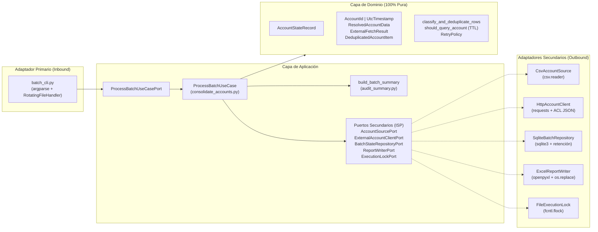

# rpa-cuentas

[](https://www.python.org/downloads/)
[](#arquitectura-y-modelo-de-dominio)
[](https://github.com/astral-sh/ruff)
[](#desarrollo-y-suite-de-pruebas)

**`rpa-cuentas`** es un procesador batch desatendido en Python para la lectura, validación, deduplicación, consulta HTTP resiliente, persistencia transaccional en SQLite y consolidación auditada de cuentas médicas en reportes Excel (`.xlsx`).

Diseñado bajo **Arquitectura Hexagonal (Puertos y Adaptadores)** y **Diseño Guiado por el Dominio (DDD táctico)**, garantiza aislamiento total de fallos por cuenta, reintentos exponenciales con *jitter* ante errores transitorios, exclusión mutua a nivel de kernel (`fcntl.flock`), reanudación incremental con vigencia temporal configurable (`STATE_TTL_SECONDS`) y retención acotada de historial operativo.

---

## Tabla de contenidos

1. [Características principales](#características-principales)
2. [Arquitectura y modelo de dominio](#arquitectura-y-modelo-de-dominio)
3. [Flujo de ejecución extremo a extremo](#flujo-de-ejecución-extremo-a-extremo)
4. [Requisitos e inicio rápido](#requisitos-e-inicio-rápido)
5. [Configuración por variables de entorno](#configuración-por-variables-de-entorno)
6. [Especificación de contratos (CSV, HTTP, SQLite, Excel y Logs)](#especificación-de-contratos-csv-http-sqlite-excel-y-logs)
7. [Códigos de salida y jerarquía de errores](#códigos-de-salida-y-jerarquía-de-errores)
8. [Decisiones de diseño](#decisiones-de-diseño)
9. [Runbook operativo (diagnóstico a las 3 a.m.)](#runbook-operativo-diagnóstico-a-las-3-am)
10. [Desarrollo y suite de pruebas](#desarrollo-y-suite-de-pruebas)

---

## Características principales

- **Clasificación y deduplicación determinista en flujo**: Lee archivos CSV codificados en `UTF-8` o `UTF-8-SIG` mediante `csv.reader`, normaliza espacios y comillas envolventes, registra incidencias por número de línea física (`LINEA_VACIA`, `NO_ENTERO`, `NO_POSITIVO`) y colapsa cuentas duplicadas preservando el orden de primera aparición y el total de repeticiones (`apariciones`).
- **Idempotencia, `COMMIT` por cuenta y TTL opcional en SQLite**: Persiste el estado inmediatamente después de procesar cada cuenta única (`save_account_state`). En reejecuciones reutiliza estados terminales (`RESUELTA`, `NO_EXISTE`) sin disparar tráfico HTTP salvo que se configure `STATE_TTL_SECONDS` y la vigencia del registro haya expirado, y reconsulta siempre las cuentas nuevas o en `FALLO_TECNICO`.
- **Retención automática de historial**: Al finalizar cada corrida (`finish_run`), el repositorio SQLite conserva las últimas `100` ejecuciones (`DEFAULT_MAX_RETAINED_RUNS`) y poda automáticamente las filas antiguas de `runs`, `run_accounts` y `run_incidents`, manteniendo intacto el catálogo maestro `accounts`.
- **Resiliencia HTTP acotada y capa anticorrupción (ACL)**: Aplica *exponential backoff* con *jitter* y soporte para el encabezado `Retry-After` exclusivamente sobre fallos transitorios (`HTTP 429`, `HTTP 5xx`, *timeouts* y errores de socket/red). Valida rigurosamente la estructura y tipos del JSON recibido antes de construir objetos de dominio.
- **Publicación atómica de reportes Excel**: Construye un libro `.xlsx` con tres hojas (`Resultados`, `Incidencias`, `Resumen`) en un archivo temporal oculto dentro del mismo directorio y reemplaza el archivo destino mediante `os.replace`, garantizando que nunca quede un reporte corrupto o a medio escribir.
- **Exclusión mutua por kernel y observabilidad estructurada**: Protege la ejecución mediante `fcntl.flock(LOCK_EX | LOCK_NB)` sobre descriptor abierto —liberado automáticamente por el sistema operativo ante cierres abruptos (`SIGKILL`) e inmune a la reutilización de PID— y emite eventos estructurados `key=value` en un log rotativo correlacionado por `run_id`.

---

## Arquitectura y modelo de dominio

El sistema aplica separación estricta entre lógica de negocio pura, casos de uso de aplicación y adaptadores de infraestructura. Las fronteras de importación están protegidas mediante pruebas estáticas sobre el árbol sintáctico (`ast`) en la suite de pruebas.



### Estructura del proyecto

```text
.
├── .env.example                                         # Plantilla de variables de entorno
├── Makefile                                             # Automatización de formato, linters y tests
├── pyproject.toml                                       # Metadatos del paquete y configuración de herramientas
├── data/
│   └── cuentas.csv                                      # Lote CSV de referencia (21 líneas de datos)
├── src/rpa_cuentas/
│   ├── __init__.py                                      # Versión del paquete
│   ├── __main__.py                                      # Punto de entrada para `python -m rpa_cuentas`
│   ├── main.py                                          # Composition Root (inyección de dependencias)
│   ├── config.py                                        # Carga y validación estricta de Settings (.env / env)
│   ├── domain/                                          # Núcleo de dominio (sin dependencias de I/O ni frameworks)
│   │   ├── entities/
│   │   │   └── account_state.py                         # Agregado AccountStateRecord e invariantes de estado
│   │   ├── value_objects/
│   │   │   ├── account_id.py                            # AccountId, RawAccountEntry, InputIncident, IncidentReason
│   │   │   └── external_snapshot.py                     # UtcTimestamp, ResolvedAccountData, ExternalFetchResult
│   │   └── services/
│   │       └── batch_policies.py                        # Deduplicación, elegibilidad de consulta (TTL) y RetryPolicy
│   ├── application/                                     # Orquestación de casos de uso y contratos de puertos
│   │   ├── dtos.py                                      # ProcessBatchCommand, ReportRow, BatchSummary, Exit Codes
│   │   ├── errors.py                                    # Jerarquía FatalBatchError de frontera operativa
│   │   ├── observability.py                             # EventLogger estructurado key=value
│   │   ├── ports/
│   │   │   ├── inbound_ports.py                         # Puerto primario ProcessBatchUseCasePort
│   │   │   └── outbound_ports.py                        # Puertos secundarios segregados por responsabilidad
│   │   └── use_cases/
│   │       ├── consolidate_accounts.py                  # Orquestador ProcessBatchUseCase
│   │       └── audit_summary.py                         # Construcción de BatchSummary y determinación de exit_code
│   └── adapters/                                        # Implementaciones concretas de infraestructura
│       ├── inbound/
│       │   └── cli/
│       │       └── batch_cli.py                         # Parser CLI, logging rotativo y formateo en stdout/stderr
│       └── outbound/
│           ├── external_services/
│           │   └── http_account_client.py               # Cliente HTTP con requests, ACL JSON y backoff con jitter
│           ├── file_io/
│           │   ├── csv_account_source.py                # Lectura streaming de CSV y limpieza de celdas
│           │   └── excel_audit_report.py                # Escritura de libro Excel y publicación atómica
│           └── persistence/
│               ├── sqlite_batch_repository.py           # Persistencia SQLite, proyección CQRS y poda de historial
│               └── file_execution_lock.py               # Exclusión mutua con fcntl.flock sobre descriptor abierto
└── tests/                                               # Suite de pruebas (126 tests)
    ├── conftest.py                                      # Fixtures y factorías compartidas
    ├── domain/                                          # Pruebas unitarias de entidades, VOs y políticas
    ├── application/                                     # Pruebas del caso de uso con dobles en memoria y reglas AST
    ├── adapters/                                        # Pruebas de contrato e integración de cada adaptador
    └── acceptance/                                      # Pruebas E2E sobre data/cuentas.csv con mocks HTTP
```

### Modelo táctico DDD y reglas de invariantes

| Componente | Tipo | Invariantes verificadas en tiempo de construcción (`__post_init__`) |
| :--- | :--- | :--- |
| `AccountId` | Value Object | Entero estricto en base 10 (`> 0`); rechaza booleanos, flotantes, cadenas no decimales y valores `<= 0` clasificando la causa en `IncidentReason`. |
| `UtcTimestamp` | Value Object | Cadena ISO-8601 no vacía con zona horaria explícita (`Z` o offset UTC). |
| `ResolvedAccountData` | Value Object | `user_id` entero positivo (`> 0`), `title` y `body` cadenas no vacías tras `strip()`. |
| `DeduplicatedAccountItem` | Value Object | Asocia un `AccountId` con `occurrences >= 1` y `first_seen_order >= 0`. |
| `ExternalFetchResult` | Value Object | Si `status == RESUELTA`, exige `payload` (`ResolvedAccountData`) y prohíbe `cause`; si es `NO_EXISTE` o `FALLO_TECNICO`, prohíbe `payload` y exige `cause` no vacía. |
| `AccountStateRecord` | Entidad / Agregado | Identidad por `AccountId` (`has_same_identity`). Si `status == RESUELTA`, exige `resolved_data`, `resolved_at` y `cause is None`. Si `status == NO_EXISTE`, exige `cause`, `resolved_at` y `resolved_data is None`. Si `status == FALLO_TECNICO`, exige `cause`, `resolved_data is None` y `resolved_at is None`. |
| `BatchClassificationResult` | Value Object | Verifica contablemente que `lines_read == len(incidents) + valid_lines` y `valid_lines - len(items) == duplicates_collapsed`. |
| `RetryPolicy` | Value Object / Policy | Exige `max_attempts >= 1`, `base_delay_seconds >= 0`, `backoff_factor >= 1.0` y `max_delay_seconds > 0` finitos. |

### Segregación de puertos secundarios (ISP y CQRS)

En `application/ports/outbound_ports.py`, la persistencia está segregada en tres protocolos específicos que `BatchStateRepositoryPort` unifica:
- **`AccountStateRepositoryPort`**: Operaciones de lectura/escritura del agregado (`get_account_state`, `save_account_state`).
- **`BatchRunAuditPort`**: Ciclo de vida de la corrida (`start_run`, `save_run_plan`, `get_run_incidents`, `finish_run`).
- **`BatchReportQueryPort`**: Proyección de lectura CQRS (`get_report_rows`) que devuelve objetos `ReportRow` listos para el reporte sin acoplar el generador de Excel al esquema relacional.

---

## Flujo de ejecución extremo a extremo

Cada invocación de `python -m rpa_cuentas run` ejecuta la siguiente secuencia determinista:

1. **Validación de argumentos y configuración (`main.py` / `config.py`)**:
   - Se parsean los argumentos CLI (`run [--input PATH]`).
   - Se cargan y validan las variables desde `.env` y el entorno del sistema (`load_settings`). Cualquier valor fuera de rango aborta antes de tocar disco o red con código `2` (`EXIT_FATAL_ERROR`).
2. **Inicialización de observabilidad (`batch_cli.py`)**:
   - Se genera un `run_id` único con formato `run-YYYYMMDDTHHMMSSZ-<8_hex>` (ej. `run-20261022T082000Z-a1b2c3d4`).
   - Se configura el `RotatingFileHandler` en `LOG_FILE_PATH` inyectando `run_id` en cada registro.
3. **Adquisición de bloqueo exclusivo (`FileExecutionLock`)**:
   - Antes de abrir la corrida, `ProcessBatchUseCase.execute` entra en el contexto de `FileExecutionLock`, que abre `LOCK_FILE_PATH` y solicita `fcntl.flock(fd, LOCK_EX | LOCK_NB)`. Si otra instancia mantiene el descriptor bloqueado, aborta con `ConcurrentExecutionError` (código `2`).
4. **Clasificación y plan del lote (`CsvAccountSource` + `classify_and_deduplicate_rows`)**:
   - Se registra el inicio en SQLite (`start_run`).
   - Se lee el archivo CSV en streaming validando que la línea 1 sea exactamente `id_cuenta`.
   - Las filas válidas se deduplican preservando el orden de primera aparición y las inválidas se convierten en `InputIncident`. El plan completo se guarda transaccionalmente en `run_accounts` y `run_incidents` (`save_run_plan`).
5. **Resolución cuenta por cuenta con `COMMIT` individual (`_resolve_accounts`)**:
   - Para cada cuenta única del plan, se consulta su estado previo en `accounts` (`get_account_state`).
   - `should_query_account(existing, now, ttl_seconds)` decide si debe consultarse:
     - Si no existe registro previo o su estado es `FALLO_TECNICO` $\rightarrow$ **se consulta**.
     - Si su estado es `RESUELTA` o `NO_EXISTE` y `STATE_TTL_SECONDS` no está definido (o no ha expirado) $\rightarrow$ **se reutiliza** (`reutilizadas_de_estado += 1`).
     - Si `STATE_TTL_SECONDS` está definido y `(now - resolved_at) >= STATE_TTL_SECONDS` $\rightarrow$ **se reconsulta** para refrescar los datos.
   - Al consultar el servicio externo (`HttpAccountClient.fetch_account`), el resultado se transforma en `AccountStateRecord` y se guarda con `COMMIT` inmediato en SQLite (`save_account_state`). Cualquier excepción no prevista del cliente es capturada por `_safe_fetch` y convertida en `FALLO_TECNICO` (`ERROR_INESPERADO_CLIENTE: <Tipo>`) para no abortar el lote.
6. **Proyección, cuadre y publicación atómica (`ExcelReportWriter`)**:
   - Se proyectan las filas de la corrida mediante un `JOIN` entre `run_accounts` y `accounts` ordenado por `position ASC` (`get_report_rows`).
   - `build_batch_summary` calcula todos los conteos y determina el código de salida (`0` o `1`).
   - `ExcelReportWriter.publish_report` escribe el archivo temporal `.{stem}.{run_id}.{pid}.tmp.xlsx` y ejecuta `os.replace` hacia `OUTPUT_EXCEL_PATH`.
7. **Cierre y poda de historial (`finish_run`)**:
   - Se actualiza `finished_at` y `exit_code` en la tabla `runs` y se eliminan las corridas que excedan las últimas `100` junto con su detalle en `run_accounts` y `run_incidents`.
   - Se imprime el resumen verificable en `stdout` y se libera el bloqueo de archivo.

---

## Requisitos e inicio rápido

### Requisitos previos

- **Sistema operativo**: Linux / macOS (requiere soporte POSIX `fcntl.flock`).
- **Python**: `>= 3.11`
- **Gestor de paquetes**: [uv](https://docs.astral.sh/uv/) (recomendado) o `pip`.

### 1. Instalación

Clona el repositorio y sincroniza el entorno con `uv`:

```bash
uv sync
```

> [!TIP]
> Si prefieres utilizar un entorno virtual estándar con `pip`:
> ```bash
> python3 -m venv .venv
> source .venv/bin/activate
> pip install -e .
> ```

### 2. Configuración opcional

El proyecto incluye valores por defecto listos para ejecutarse sin configuración adicional. Si deseas personalizarlos:

```bash
cp .env.example .env
```

### 3. Ejecución del procesador

Ejecuta el lote predeterminado (`data/cuentas.csv`):

```bash
uv run python -m rpa_cuentas run
```

Para procesar un archivo CSV distinto (sobreescribiendo `INPUT_CSV_PATH`):

```bash
uv run python -m rpa_cuentas run --input ruta/a/otro_lote.csv
```

Para ejecutar forzando el refresco de cuentas en estado terminal cuya antigüedad supere un umbral (por ejemplo, 24 horas = `86400` segundos):

```bash
STATE_TTL_SECONDS=86400 uv run python -m rpa_cuentas run
```

### Ejemplo de salida estándar

En la primera ejecución sobre `data/cuentas.csv` (21 filas tras el encabezado: 18 válidas con 3 duplicados y 3 incidencias de entrada; cuentas `101` y `150` devuelven `HTTP 404` en JSONPlaceholder):

```text
=== Resumen de Ejecución (run-20261022T120000Z-a1b2c3d4) ===
lineas_leidas=21
lineas_vacias=1
invalidas_no_entero=1
invalidas_no_positivo=1
total_incidencias=3
filas_validas=18
duplicados_colapsados=3
cuentas_unicas=15
consultadas_en_ejecucion=15
reutilizadas_de_estado=0
resueltas=13
no_existe=2
fallos_tecnicos=0
detalle_fallos_por_causa=ninguno
codigo_salida=0
```

Si ejecutas el comando una segunda vez de forma inmediata (sin `STATE_TTL_SECONDS` vencido), observarás `consultadas_en_ejecucion=0` y `reutilizadas_de_estado=15`.

---

## Configuración por variables de entorno

El orden de precedencia al cargar la configuración en `load_settings` es:
1. Argumento CLI `--input` (exclusivo para la ruta del CSV de entrada).
2. Variables de entorno activas en el proceso (`os.environ`).
3. Archivo `.env` en el directorio de trabajo.
4. Valores por defecto definidos en `Settings`.

| Variable | Valor por defecto | Tipo y restricción de validación | Descripción |
| :--- | :--- | :--- | :--- |
| `EXTERNAL_API_BASE_URL` | `https://jsonplaceholder.typicode.com` | URL no vacía con prefijo `http://` o `https://` | URL base del servicio externo donde se consulta `GET {base_url}/posts/{id}`. |
| `HTTP_TIMEOUT_SECONDS` | `10.0` | `float` finito `> 0` | Tiempo máximo de espera por cada petición HTTP individual en segundos. |
| `RETRY_MAX_ATTEMPTS` | `4` | `int` en base 10 `>= 1` | Número máximo de intentos totales por cuenta ante fallos transitorios (`1` intento inicial + hasta `N-1` reintentos). |
| `RETRY_BASE_DELAY_SECONDS` | `1.0` | `float` finito `>= 0` | Espera base en segundos para el cálculo de *exponential backoff* y *jitter*. |
| `RETRY_BACKOFF_FACTOR` | `2.0` | `float` finito `>= 1.0` | Factor multiplicador exponencial entre intentos consecutivos. |
| `RETRY_MAX_DELAY_SECONDS` | `30.0` | `float` finito `>= RETRY_BASE_DELAY_SECONDS` (`> 0` en `RetryPolicy`) | Tope máximo de espera en segundos entre reintentos (aplica tanto al cálculo exponencial como a `Retry-After`). |
| `REQUEST_DELAY_SECONDS` | `0.0` | `float` finito `>= 0` | Pausa preventiva opcional en segundos antes de iniciar la consulta HTTP de cada cuenta. |
| `INPUT_CSV_PATH` | `data/cuentas.csv` | Ruta no vacía (`!= "."`) | Ruta del archivo CSV de entrada (sobreescribible mediante `--input`). |
| `OUTPUT_EXCEL_PATH` | `output/consolidado_cuentas.xlsx` | Ruta no vacía con extensión `.xlsx` | Ruta destino donde se publica atómicamente el reporte Excel consolidado. |
| `SQLITE_DB_PATH` | `state/rpa_cuentas.db` | Ruta no vacía (`!= "."`) | Ruta del archivo de base de datos SQLite de estado e historial de corridas. |
| `LOG_FILE_PATH` | `logs/rpa_cuentas.log` | Ruta no vacía (`!= "."`) | Ruta del archivo de log rotativo (`5 MB` máximos por archivo, hasta `3` respaldos). |
| `LOCK_FILE_PATH` | `state/rpa_cuentas.lock` | Ruta no vacía (`!= "."`) | Ruta del archivo de bloqueo exclusivo de kernel (`fcntl.flock`). |
| `LOG_LEVEL` | `INFO` | `DEBUG`, `INFO`, `WARNING`, `ERROR`, `CRITICAL` | Nivel de severidad mínimo para el registro de eventos en el archivo de log. |
| `STATE_TTL_SECONDS` | *(sin definir / `None`)* | `float` finito `>= 0` (opcional) | Tiempo de vida máximo en segundos para reutilizar cuentas en estado terminal (`RESUELTA` o `NO_EXISTE`). Si se omite o queda vacío, los estados terminales no caducan. |

---

## Especificación de contratos (CSV, HTTP, SQLite, Excel y Logs)

### 1. Contrato de entrada CSV (`CsvAccountSource`)

- **Codificación**: `UTF-8` o `UTF-8 con BOM` (`utf-8-sig`). Cualquier byte inválido para UTF-8 aborta la corrida con `InputSourceError` (código `2`).
- **Encabezado obligatorio**: La línea física `1` debe contener exactamente una columna con el texto `id_cuenta` (se ignoran espacios exteriores en el nombre del encabezado). Si el archivo está vacío, no existe, es un directorio o el encabezado no coincide, se lanza `InputSourceError`.
- **Normalización por celda (`clean_csv_cell`)**:
  1. Se recortan espacios en blanco exteriores (`strip()`).
  2. Si la cadena resultante comienza y termina con el mismo carácter de comilla (`"..."` o `'...'`), se retira ese par de comillas envolventes y se vuelve a aplicar `strip()` (por ejemplo, `"42"` $\rightarrow$ `42`, ` 23 ` $\rightarrow$ `23`).
- **Clasificación de incidencias por fila (`parse_raw_entry`)**:
  - `LINEA_VACIA`: la celda limpia queda vacía (`""`).
  - `NO_ENTERO`: la celda limpia no es un literal entero decimal ASCII en base 10 (ej. `abc`, `12.5`, `1,000`, `12;34`).
  - `NO_POSITIVO`: la celda es un entero decimal válido pero su valor es `<= 0` (ej. `0`, `-5`).

### 2. Contrato del servicio HTTP externo y causas de fallo (`HttpAccountClient`)

Para cada cuenta que requiere consulta se realiza `GET {EXTERNAL_API_BASE_URL}/posts/{id_cuenta}` con el encabezado `Accept: application/json`.

Si la respuesta es `HTTP 200 OK`, la función `validate_external_payload` actúa como *Anti-Corruption Layer (ACL)* verificando en orden:
1. Que el cuerpo sea JSON válido y su raíz sea un objeto (`Mapping`).
2. Que contenga los 4 campos requeridos: `userId`, `id`, `title`, `body`.
3. Que `id` sea un entero (`int` y no `bool`) y coincida exactamente con `id_cuenta`.
4. Que `userId` sea un entero positivo (`> 0`) y tanto `title` como `body` sean cadenas (`str`) no vacías tras `strip()`.

#### Catálogo completo de causas registradas en `causa`

| Estado resultante | Categoría (`ErrorCategory`) | Valor exacto en columna `causa` | Condición disparadora |
| :--- | :--- | :--- | :--- |
| `RESUELTA` | *(ninguna)* | `""` (`None` en dominio) | `HTTP 200 OK` con payload JSON que supera todas las validaciones de la ACL. |
| `NO_EXISTE` | `NEGOCIO` | `RECURSO_NO_ENCONTRADO` | `HTTP 404 Not Found`. |
| `FALLO_TECNICO` | `TECNICO_TRANSITORIO` | `TIMEOUT_AGOTADO` | Se agotaron `RETRY_MAX_ATTEMPTS` por `requests.Timeout`. |
| `FALLO_TECNICO` | `TECNICO_TRANSITORIO` | `ERROR_RED_AGOTADO` | Se agotaron `RETRY_MAX_ATTEMPTS` por errores de conexión/red (`requests.RequestException`). |
| `FALLO_TECNICO` | `TECNICO_TRANSITORIO` | `HTTP_429_AGOTADO` | Se agotaron `RETRY_MAX_ATTEMPTS` recibiendo `HTTP 429 Too Many Requests`. |
| `FALLO_TECNICO` | `TECNICO_TRANSITORIO` | `HTTP_5XX_AGOTADO: <status>` | Se agotaron `RETRY_MAX_ATTEMPTS` recibiendo error de servidor `500..599` (ej. `HTTP_5XX_AGOTADO: 503`). |
| `FALLO_TECNICO` | `TECNICO_DEFINITIVO` | `HTTP_4XX_DEFINITIVO: <status>` | Respuesta cliente `4xx` distinta de `404` y `429` (ej. `400`, `401`, `403`). Sin reintento. |
| `FALLO_TECNICO` | `TECNICO_DEFINITIVO` | `JSON_INVALIDO` | `HTTP 200` con cuerpo que no puede decodificarse como JSON. Sin reintento. |
| `FALLO_TECNICO` | `TECNICO_DEFINITIVO` | `PAYLOAD_NO_ES_OBJETO_JSON` | `HTTP 200` cuyo JSON raíz es una lista, número, cadena o `null`. Sin reintento. |
| `FALLO_TECNICO` | `TECNICO_DEFINITIVO` | `CAMPOS_FALTANTES: <lista>` | `HTTP 200` sin alguno de `userId`, `id`, `title`, `body`. Sin reintento. |
| `FALLO_TECNICO` | `TECNICO_DEFINITIVO` | `TIPO_INVALIDO: id` | El campo `id` del JSON no es un entero o es booleano. Sin reintento. |
| `FALLO_TECNICO` | `TECNICO_DEFINITIVO` | `ID_NO_COINCIDE: esperado=<X>, recibido=<Y>` | El `id` devuelto por el servicio no coincide con el `id_cuenta` solicitado. Sin reintento. |
| `FALLO_TECNICO` | `TECNICO_DEFINITIVO` | `TIPO_INVALIDO: userId` | `userId` no es entero, es booleano o es `<= 0`. Sin reintento. |
| `FALLO_TECNICO` | `TECNICO_DEFINITIVO` | `TIPO_O_VALOR_INVALIDO: title` | `title` no es `str` o está vacío/solo espacios. Sin reintento. |
| `FALLO_TECNICO` | `TECNICO_DEFINITIVO` | `TIPO_O_VALOR_INVALIDO: body` | `body` no es `str` o está vacío/solo espacios. Sin reintento. |
| `FALLO_TECNICO` | `TECNICO_DEFINITIVO` | `ERROR_INESPERADO_CLIENTE: <Excepción>` | Excepción no prevista capturada por la barrera de aislamiento `_safe_fetch` en el caso de uso. |

### 3. Esquema SQLite y política de retención (`SqliteBatchRepository`)

La base de datos en `SQLITE_DB_PATH` mantiene cuatro tablas:

```sql
CREATE TABLE IF NOT EXISTS accounts (
    id INTEGER PRIMARY KEY, status TEXT NOT NULL, attempts INTEGER NOT NULL,
    cause TEXT NULL, user_id INTEGER NULL, title TEXT NULL, body TEXT NULL,
    last_attempt_at TEXT NOT NULL, resolved_at TEXT NULL
);
CREATE TABLE IF NOT EXISTS runs (
    run_id TEXT PRIMARY KEY, started_at TEXT NOT NULL, finished_at TEXT NULL,
    input_path TEXT NOT NULL, exit_code INTEGER NULL
);
CREATE TABLE IF NOT EXISTS run_accounts (
    run_id TEXT NOT NULL, account_id INTEGER NOT NULL, occurrences INTEGER NOT NULL,
    position INTEGER NOT NULL, PRIMARY KEY (run_id, account_id)
);
CREATE TABLE IF NOT EXISTS run_incidents (
    run_id TEXT NOT NULL, line_number INTEGER NOT NULL, raw_value TEXT NOT NULL,
    reason TEXT NOT NULL, PRIMARY KEY (run_id, line_number)
);
```

- **`accounts`**: Almacena el último estado conocido de cada `id_cuenta` mediante `INSERT ... ON CONFLICT(id) DO UPDATE` con `COMMIT` inmediato tras cada cuenta. Nunca se borra durante la poda de corridas.
- **`runs`, `run_accounts`, `run_incidents`**: Registran la trazabilidad de cada ejecución. Al invocarse `finish_run`, se retienen únicamente las últimas `100` corridas (`ORDER BY rowid DESC LIMIT 100`) y se eliminan automáticamente las filas huérfanas en `run_accounts` y `run_incidents`.

### 4. Estructura del reporte Excel (`ExcelReportWriter`)

El archivo publicado en `OUTPUT_EXCEL_PATH` contiene siempre tres hojas con encabezados exactos:

1. **Hoja `Resultados`**:
   - Columnas: `id_cuenta`, `estado`, `causa`, `apariciones`, `user_id`, `titulo`, `cuerpo`, `intentos`, `fecha_consulta`.
   - Contiene una fila por cada cuenta única válida del archivo de entrada, respetando el orden de primera aparición (`position ASC`).
   - `fecha_consulta` refleja `resolved_at` para estados terminales o `last_attempt_at` para `FALLO_TECNICO`.
2. **Hoja `Incidencias`**:
   - Columnas: `linea`, `valor_original`, `motivo`.
   - Contiene todas las filas rechazadas en el CSV ordenadas por número de línea física ascendente (`line_number ASC`).
3. **Hoja `Resumen`**:
   - Columnas: `metrica`, `valor`.
   - Incluye `run_id` seguido de las 15 métricas de `BatchSummary.to_metric_rows()`, las cuales cumplen siempre las siguientes identidades de auditoría:
     - `lineas_leidas == total_incidencias + filas_validas`
     - `total_incidencias == lineas_vacias + invalidas_no_entero + invalidas_no_positivo`
     - `filas_validas == cuentas_unicas + duplicados_colapsados`
     - `cuentas_unicas == consultadas_en_ejecucion + reutilizadas_de_estado`
     - `cuentas_unicas == resueltas + no_existe + fallos_tecnicos`

### 5. Formato de logs y catálogo de eventos (`EventLogger`)

El archivo `LOG_FILE_PATH` utiliza `RotatingFileHandler` (`maxBytes = 5_242_880`, `backupCount = 3`, `encoding = "utf-8"`) con el formato:

```text
YYYY-MM-DDTHH:MM:SS+0000 LEVEL [run_id=run-...] logger_name event=<nombre_evento> clave=valor ...
```

| Evento (`event=...`) | Nivel | Emisor | Campos clave incluidos |
| :--- | :---: | :--- | :--- |
| `batch_started` | `INFO` | `rpa_cuentas.application` | `run_id`, `input_path`, `started_at` |
| `input_classified` | `INFO` | `rpa_cuentas.application` | `run_id`, `lines_read`, `valid_lines`, `unique_accounts`, `duplicates_collapsed`, `incidents` |
| `state_reused` | `INFO` | `rpa_cuentas.application` | `run_id`, `account_id`, `status`, `occurrences` |
| `retry_scheduled` | `WARNING` | `rpa_cuentas.adapters.http_account_client` | `account_id`, `attempt` (`k/N`), `category`, `cause`, `wait_seconds` |
| `unexpected_client_error` | `ERROR` | `rpa_cuentas.application` | `run_id`, `account_id`, `cause`, `detail` |
| `account_processed` | `INFO` | `rpa_cuentas.application` | `run_id`, `account_id`, `status`, `attempts`, `cause` |
| `batch_finished` | `INFO` | `rpa_cuentas.application` | `run_id`, `exit_code`, `resolved`, `not_found`, `technical_failures` |
| `summary_emitted` | `INFO` | `rpa_cuentas` | Resumen completo separado por ` \| ` |
| `fatal_batch_error` | `ERROR` | `rpa_cuentas` | `detail` (subclase de `FatalBatchError`) |
| `unexpected_fatal_error` | `ERROR` (con traceback) | `rpa_cuentas` | `detail` |

---

## Códigos de salida y jerarquía de errores

El proceso devuelve códigos de retorno estándar diseñados para orquestadores desatendidos (`cron`, `systemd`, Airflow, Control-M, GitHub Actions):

| Código | Constante | Condición |
| :---: | :--- | :--- |
| `0` | `EXIT_SUCCESS` | Lote completado y reporte Excel publicado con `fallos_tecnicos == 0` (las cuentas en `NO_EXISTE` y las incidencias de entrada CSV son resultados de negocio/validación controlados y no penalizan el código de salida). |
| `1` | `EXIT_PARTIAL_FAILURE` | Lote completado y reporte Excel publicado, pero al menos una cuenta única finalizó en estado `FALLO_TECNICO` (`fallos_tecnicos >= 1`). |
| `2` | `EXIT_FATAL_ERROR` | Aborto global del proceso por error de configuración/CLI (`ConfigurationError`, `CliUsageError`) o por una excepción de frontera (`FatalBatchError`): `ConcurrentExecutionError`, `InputSourceError`, `PersistenceError` o `ReportPublicationError`. |

> [!IMPORTANT]
> Si ocurre un error de código `2` antes o durante la generación del Excel, cualquier archivo `.xlsx` publicado por una corrida anterior permanece intacto gracias al uso de archivo temporal y `os.replace`.

---

## Decisiones de diseño

### 1. Política sobre cuentas duplicadas

Cuando un mismo `id_cuenta > 0` aparece múltiples veces en el CSV (incluso con formatos crudos distintos como `7`, ` 7 ` o `"7"`), `classify_and_deduplicate_rows` **los colapsa en una única entrada por lote, conservando la posición de su primera aparición y acumulando el conteo en `apariciones`**.

- **Protección del servicio externo**: Evita multiplicar peticiones HTTP idénticas dentro de la misma corrida.
- **Integridad analítica**: Mantiene una relación 1:1 por cuenta médica en la hoja `Resultados` sin perder la trazabilidad del volumen original (`sum(apariciones) == filas_validas`).

### 2. Frontera de reintentos y fórmula de *backoff* (`RetryPolicy`)

El dominio distingue estrictamente entre errores de negocio, fallos técnicos definitivos y fallos técnicos transitorios:

| Categoría | Condición | ¿Reintenta en la misma corrida? | ¿Se reconsulta en corridas futuras? | Justificación |
| :--- | :--- | :---: | :---: | :--- |
| **`NEGOCIO`** (`NO_EXISTE`) | `HTTP 404` | **No** (`1` intento) | **No** (salvo expiración de `STATE_TTL_SECONDS`) | El recurso no existe en el sistema origen; reintentar inmediatamente solo desperdicia cuota. |
| **`TECNICO_DEFINITIVO`** (`FALLO_TECNICO`) | `HTTP 4xx` (`!= 404, 429`) o violación de contrato JSON en `HTTP 200` | **No** (`1` intento) | **Sí** | Una violación de protocolo o esquema JSON es determinista en el instante de la corrida, pero debe volver a consultarse en la siguiente ejecución cuando el proveedor corrija la anomalía. |
| **`TECNICO_TRANSITORIO`** (`FALLO_TECNICO`) | `HTTP 429`, `HTTP 5xx`, `Timeout`, error de socket/red | **Sí** (hasta `RETRY_MAX_ATTEMPTS`) | **Sí** (si agotó intentos) | Fallos efímeros de red, saturación o *rate limiting*. |

Para cada reintento transitorio ($1 \le \text{attempt} < \text{max\_attempts}$), el tiempo de espera se calcula en `calculate_retry_delay`:
- Si la respuesta incluye un encabezado `Retry-After` numérico finito $\ge 0$:
  $$\text{delay} = \min(\text{Retry-After}, \text{max\_delay})$$
- En caso contrario, se aplica *exponential backoff* con *jitter* uniforme acotado ($\text{jitter\_ratio} \in [0, 0.25]$):
  $$\text{delay} = \min\left(\text{base\_delay} \cdot \text{backoff\_factor}^{\text{attempt}-1} + \text{jitter\_ratio} \cdot \text{base\_delay},\ \text{max\_delay}\right)$$

### 3. Vigencia temporal de estados terminales (`STATE_TTL_SECONDS`)

Por defecto (`STATE_TTL_SECONDS` no definido), las cuentas en estado `RESUELTA` o `NO_EXISTE` se consideran inmutables para maximizar el ahorro de llamadas HTTP en reanudaciones ante caídas. Cuando el negocio requiere refrescar periódicamente cuentas ya consolidadas o verificar si una cuenta antes inexistente (`NO_EXISTE`) ya fue dada de alta, basta con definir `STATE_TTL_SECONDS`: `AccountStateRecord.should_be_queried` comparará `(now - resolved_at).total_seconds() >= ttl_seconds` y forzará la reconsulta transparente.

### 4. Bloqueo exclusivo de kernel (`fcntl.flock`) frente a reciclaje de PID

A diferencia de los bloqueos basados únicamente en `O_CREAT | O_EXCL` + verificación de `os.kill(pid, 0)` —que sufren falsos positivos permanentes cuando el sistema operativo recicla el PID de un proceso muerto o cuando el proceso corre como `PID 1` dentro de un contenedor reiniciado—, `FileExecutionLock` mantiene abierto el descriptor de archivo (`self._fd`) con un bloqueo exclusivo no bloqueante del kernel (`fcntl.flock(fd, fcntl.LOCK_EX | fcntl.LOCK_NB)`):
- Si el proceso termina normalmente o por excepción en Python, `__exit__` elimina el archivo, desbloquea y cierra el descriptor.
- Si el proceso muere abruptamente (`SIGKILL` o corte de energía), el kernel cierra automáticamente todos sus descriptores abiertos y libera el `flock` de inmediato, permitiendo que la siguiente corrida adquiera el bloqueo sin intervención manual.

---

## Runbook operativo: ¿Qué hacer si falla a las 3 a.m.?

### Paso 1: Identificar la corrida y el código de salida en el log

Revisa las últimas líneas del archivo de log rotativo:

```bash
tail -n 40 logs/rpa_cuentas.log
```

Cada línea contiene `[run_id=run-...]` y el evento estructurado:
- Si finaliza con `event=batch_finished ... exit_code=1`, sigue el **Escenario A**.
- Si finaliza con `event=fatal_batch_error` o `event=unexpected_fatal_error` (o mensaje `ERROR FATAL` en `stderr` con código `2`), sigue el **Escenario B**.

### Escenario A — `codigo_salida=1` (`EXIT_PARTIAL_FAILURE`)

1. **Diagnóstico**: El proceso completó el lote y publicó `output/consolidado_cuentas.xlsx`, pero una o más cuentas agotaron sus reintentos o devolvieron un payload inválido (`FALLO_TECNICO`).
2. **Inspeccionar las cuentas afectadas y sus causas**:
   ```bash
   grep "status=FALLO_TECNICO" logs/rpa_cuentas.log | tail -n 20
   ```
3. **Recuperación selectiva**:
   Una vez restablecido el servicio externo, relanza exactamente el mismo comando:
   ```bash
   uv run python -m rpa_cuentas run
   ```
   - Las cuentas que ya habían quedado en `RESUELTA` o `NO_EXISTE` en `state/rpa_cuentas.db` se reutilizarán sin tráfico HTTP (`reutilizadas_de_estado`).
   - Solo se consultarán las cuentas que permanecían en `FALLO_TECNICO`, publicando el nuevo Excel consolidado con `codigo_salida=0`.

### Escenario B — `codigo_salida=2` (`EXIT_FATAL_ERROR`)

1. **Diagnóstico**: El proceso abortó globalmente. El reporte Excel de la corrida previa (si existía) no fue modificado.
2. **Acción correctiva según la causa**:
   - **Caída abrupta previa (`SIGKILL`, reinicio de máquina)**: Gracias al `COMMIT` por cuenta en SQLite y a la liberación automática del `flock` por el kernel, basta con relanzar `uv run python -m rpa_cuentas run` para continuar desde la primera cuenta no resuelta.
   - **Ejecución simultánea detectada (`ConcurrentExecutionError`)**: Otra instancia del proceso está actualmente en ejecución manteniendo el bloqueo sobre `state/rpa_cuentas.lock`. Verifica el PID activo con `cat state/rpa_cuentas.lock` y `ps -fp $(cat state/rpa_cuentas.lock)`.
   - **Error en archivo de entrada (`InputSourceError`)**: Verifica que `INPUT_CSV_PATH` (o el archivo pasado a `--input`) exista, tenga permisos de lectura, esté codificado en UTF-8 y su primera línea sea exactamente `id_cuenta`.
   - **Error de configuración (`ConfigurationError`)**: Contrasta las variables de `.env` o del entorno contra la tabla de restricciones de este documento.

---

## Desarrollo y suite de pruebas

El repositorio cuenta con una suite de **126 pruebas automatizadas** organizadas en cuatro niveles:
- **`tests/domain/`**: Pruebas unitarias de `AccountId`, `UtcTimestamp`, `ResolvedAccountData`, `AccountStateRecord`, deduplicación, elegibilidad con `STATE_TTL_SECONDS` y `RetryPolicy`.
- **`tests/application/`**: Pruebas del caso de uso `ProcessBatchUseCase` con dobles en memoria (`InMemoryBatchStateRepository`, `FakeExternalAccountClient`), recuperación tras caída a mitad de lote y validación AST de fronteras arquitectónicas.
- **`tests/adapters/`**: Pruebas de contrato en paridad (`InMemory` vs `SqliteBatchRepository`), retención de corridas en SQLite, `HttpAccountClient` (con `responses`), `CsvAccountSource`, atomicidad de `ExcelReportWriter`, `FileExecutionLock` (incluyendo reúso de PID), `Settings` y `batch_cli`.
- **`tests/acceptance/`**: Pruebas de extremo a extremo sobre `data/cuentas.csv` validando primera corrida, segunda corrida idempotente (`0` llamadas HTTP) y recuperación selectiva de fallos técnicos.

Ejecuta los objetivos del `Makefile` para verificar calidad y pruebas:

```bash
# Ejecuta formato (ruff format --check), linter (ruff check + pylint 10/10) y pytest
make check

# Ejecuta únicamente la suite de pruebas
make test

# Ejecuta únicamente el análisis estático (Ruff + Pylint)
make lint

# Formatea automáticamente el código fuente y las pruebas
make format
```
